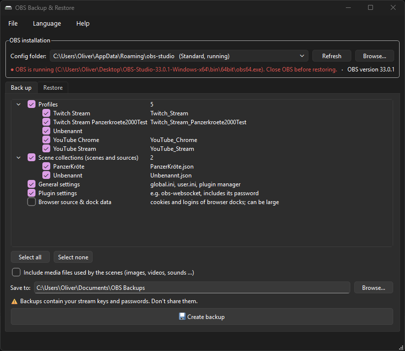

# Backup & Restore for OBS

A simple tool with a graphical interface to **back up and restore [OBS Studio](https://obsproject.com/)**: profiles, scene collections (scenes and sources), settings, plugin settings and, optionally, the media files your scenes use.

Works on **Windows** and **Linux**. The interface is in **English** and **German**. macOS is not supported yet.

> **AI disclosure:** Most of the code was written with an AI coding assistant (Claude Code by Anthropic) and is reviewed by the maintainer. See [AI disclosure](#ai-disclosure).



## Features

- **Finds OBS automatically.** It detects a running OBS and uses the config folder that OBS uses, including **portable installs**, **Flatpak** and **Snap**. You can also pick any folder by hand.
- **Choose what to back up:** single profiles, single scene collections, general settings, plugin settings, browser dock logins.
- **Media files, optional.** Images, videos, sounds and other files your sources point to can go into the backup. On restore, files that are missing on the computer are put into a folder you choose, and the scene collections are updated to point there. This makes moving to a new PC easy.
- **Safe restore.**
  - Restoring is blocked while OBS is running, because OBS writes its files when it closes and would overwrite the restore.
  - The current state is backed up before every restore. If that backup can't save a file the restore would replace, nothing is restored.
  - You choose which items to restore.
  - Files that couldn't be read when a backup was made (usually because OBS had them open) are never deleted by restoring that backup.
- **Plain zip files.** Every backup is a normal `.zip` with a `manifest.json`, so you can open it without this tool.

## Download

Get the latest version from the [Releases](../../releases) page. No installation is needed.

| System  | File                                  |
|---------|---------------------------------------|
| Windows | `Backup-Restore-for-OBS-windows.exe`  |
| Linux   | `Backup-Restore-for-OBS-linux.tar.gz` |

Each release also has a `SHA256SUMS.txt` for checking the downloads.

The apps are built by GitHub Actions from the source code in this repository ([release workflow](.github/workflows/release.yml)), but they are not code-signed yet. Windows SmartScreen may therefore warn you the first time: click “More info” → “Run anyway”.

To uninstall, delete the app. Its settings are stored in the registry under `HKEY_CURRENT_USER\Software\Backup & Restore for OBS` (Windows) or in `~/.config/Backup & Restore for OBS/` (Linux). Your backups stay where you saved them.

## Usage

1. Start Backup & Restore for OBS. It shows the OBS config folder it found and whether OBS is running.
2. **Back up** tab: tick what you want, optionally include media files, and click **Create backup**. Backups go to `Documents/OBS Backups` by default.
3. **Restore** tab: close OBS, pick a backup, tick what you want to restore and click **Restore**. Then start OBS.

> ⚠ **Backups contain secrets:** stream keys (in each profile's `service.json`), the obs-websocket password and, if selected, browser dock logins. Keep backups private, and don't attach them to bug reports.

## What gets backed up

The OBS config folder is in a different place depending on the system:

| System              | OBS config folder                                         |
|---------------------|-----------------------------------------------------------|
| Windows             | `%APPDATA%\obs-studio`                                    |
| Linux               | `~/.config/obs-studio`                                    |
| Linux (Flatpak)     | `~/.var/app/com.obsproject.Studio/config/obs-studio`      |
| Linux (Snap)        | `~/snap/obs-studio/current/.config/obs-studio`            |
| Portable install    | `<OBS folder>/config/obs-studio`                          |

| Item                       | Files                                                    | Default |
|----------------------------|----------------------------------------------------------|---------|
| Profiles                   | `basic/profiles/<profile>/`                              | on      |
| Scene collections          | `basic/scenes/<name>.json` (scenes, sources, filters, transitions) | on |
| General settings           | `global.ini`, `user.ini`, `plugin_manager/`              | on      |
| Plugin settings            | `plugin_config/*` except `obs-browser`                   | on      |
| Installed plugins          | `plugins/` (Linux user plugin folder)                    | on      |
| Browser source & dock data | `plugin_config/obs-browser/` without caches (cookies, logins) | off |
| Media files                | Files the scene collections refer to by absolute path    | off     |

Not backed up: logs, crash reports, caches, and OBS itself. Plugins installed system-wide (for example in `C:\ProgramData\obs-studio\plugins` or the OBS program folder) are not included. Reinstall them on a new computer. Folders used by slideshow sources are not copied either; only single files are.

### Backup file format

```
obs-backup_2026-11-22_09-36-10.zip
├── manifest.json          what is inside, OBS version, source OS, media list
├── config/…               files from the OBS config folder, same layout
└── media/0001_logo.png    optional media copies
```

## Privacy

Backup & Restore for OBS does not send any information to other networked systems unless the user specifically requests it. It works only with files on your computer. It has no telemetry, no update check and no accounts.

## AI disclosure

This project was built with the AI coding assistant [Claude Code](https://claude.com/claude-code) by Anthropic.

- **Written with AI:** most of the source code, the tests, the build and release scripts, the German translation and most of this documentation.
- **Done by the maintainer:** the idea and requirements, the decisions on features, naming, licensing and releases, testing with real OBS setups, the screenshots, and reviewing the code.

The maintainer reviews the code and is responsible for it. Commits made with the AI assistant are marked with a `Co-Authored-By: Claude` line in the git history.

Found a bug? Please [open an issue](../../issues).

## Run from source

The project uses [uv](https://docs.astral.sh/uv/) to manage Python, the dependencies and the commands. Install uv, then:

```bash
git clone https://github.com/OliverGras/backup-restore-for-obs.git
cd backup-restore-for-obs
uv sync                          # create .venv with the locked dependencies
uv run backup-restore-for-obs    # start the app
uv run pytest                    # run the tests
```

The project needs **Python 3.15** (set in `.python-version`; uv installs it if needed). It uses 3.15 features such as lazy imports and `frozendict`. Dependency versions are pinned in `uv.lock`. To update them, run `uv lock --upgrade` and commit the new lock file.

Build a standalone app (output in `dist/`):

```bash
uv run python packaging/build.py
```

To release, set the version in [`src/obs_backup/__init__.py`](src/obs_backup/__init__.py), commit, then push a tag with the same version (`git tag 1.0.0 && git push origin 1.0.0`). GitHub Actions builds the apps for all three systems and creates a draft release with them.

## Project layout

```
src/obs_backup/
  obs/              knowledge about OBS Studio
    locator.py        find running OBS and its config folder (standard, portable, Flatpak, Snap)
    config.py         read profiles, scene collections and the OBS version
    media.py          find and rewrite media file paths in scene collections
  backup/           backup files
    layout.py         how a backup zip is organised
    models.py         Selection (what to back up or restore) and result types
    manifest.py       manifest.json inside every backup; listing backups
    collect.py        which files and media a selection covers
    create.py         writing a backup
    restore.py        restoring a backup
  i18n/             UI texts: one file per language (en.py, de.py)
  gui/              PySide6 interface: main window, OBS panel, backup and restore tabs, …
  legal.py          license texts shown under Help → About → Licenses
  licenses/         license texts of the bundled third-party components
packaging/          build script for the standalone apps
tests/              pytest tests, grouped like the code (backup/, obs/, gui/)
```

## Contributing

Issues and pull requests are welcome.

- **Code style:** the code is formatted with [ruff](https://docs.astral.sh/ruff/). Install the git hooks once with `uv run pre-commit install`; they then sort imports and format the code on every commit. CI checks formatting (`uv run ruff format --check`), lint rules (`uv run ruff check`) and types (`uv run pyright`, the checker behind VS Code's Pylance).
- **To add a language**, copy [`src/obs_backup/i18n/en.py`](src/obs_backup/i18n/en.py) to `<language code>.py`, translate the texts and add the module to `_MODULES` in [`src/obs_backup/i18n/__init__.py`](src/obs_backup/i18n/__init__.py). Tests check that no text is missing and that the `{placeholders}` match.

## License

Backup & Restore for OBS is licensed under the [MIT License](LICENSE).

The ready-to-run apps also contain third-party components under their own licenses. Most notably, they use [Qt](https://www.qt.io/) and [PySide6](https://wiki.qt.io/Qt_for_Python) under the GNU LGPL v3. See [THIRD_PARTY_NOTICES.md](THIRD_PARTY_NOTICES.md) for the full list, the source code links and the license texts. They can also be read in the app under Help → About Backup & Restore for OBS → Licenses.

Backup & Restore for OBS is an independent project. It is not affiliated with or endorsed by the OBS Project. “OBS” and “OBS Studio” are trademarks of the OBS Project.
